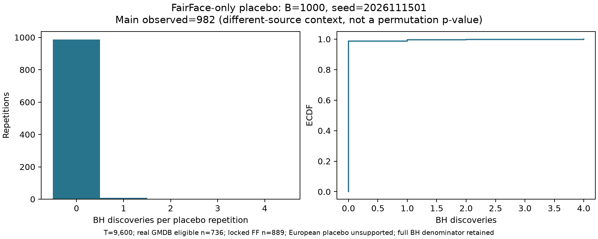
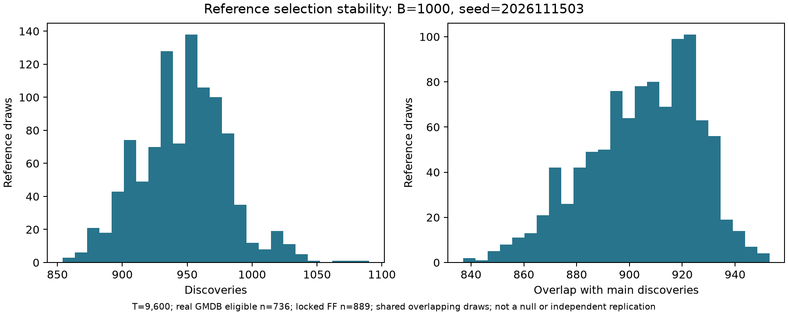

# Three-category sensitivity results — November 15, 2026

All three sensitivity experiments completed against the new race-stratified baseline: 9,600 planned
hypotheses, 80 eligible syndrome/category cells, 67 syndromes, 736 eligible patients and 982 original
discoveries. Each sensitivity retains the full planned correction denominator. Historical primary,
manuscript and publication artifacts remain unchanged.

## Findings and limits

| Experiment | Repetitions | Aggregate result |
| --- | ---: | --- |
| FairFace-only placebo | 1,000 | 13 runs had any BH discoveries; mean 0.021, median 0, 95th percentile 0, maximum 4 |
| Within-race GMDB label permutation | 100,000 | 103 empirical point-estimate BH discoveries; 80 overlap the main findings with concordant effect direction |
| Within-race/sex/age GMDB label permutation | 100,000 | 92 empirical point-estimate BH discoveries; 58 overlap the main findings with concordant effect direction |
| Fixed-allocation FairFace reference resampling | 1,000 | 849/982 original discoveries meet the prespecified descriptive stability rule; 133 do not |

**The permutation decisions remain Monte Carlo-sensitive.** None remains below q<.05 under the
conservative simultaneous Monte Carlo upper bounds at 100,000 repetitions. The 55 associations
meeting the point-estimate cross-design criteria are descriptive candidates; no list of ten
Monte Carlo-certain robust associations is estimable from this run. The empirical p-value floor
is 1/100,001, and zero exceedances never produce p=0.

The placebo supports 2,760 hypotheses. All 6,840 European hypotheses retain p=1 because the locked
European reference already uses all 647 available FairFace images, leaving no disjoint pseudo-cases.
African and Asian placebo groups use shared references disjoint from their entire pseudo-case pools.
The same-source placebo does not yield an inferential p-value for GMDB-versus-FairFace syndrome effects.

Reference stability means global BH q<.05 in at least 80% of draws and agreement with the original g
sign in at least 95%. The breakdown matters because European reference photographs cannot vary:

| Recorded category | Original discoveries | Descriptively stable | Reference photographs vary |
| --- | ---: | ---: | --- |
| African | 135 | 76 | Yes |
| Asian | 252 | 193 | Yes |
| European | 595 | 580 | No |

Thus 269/387 original African/Asian findings are stable in groups where reference photographs vary.
European g values remain fixed; their global q values can change through the other groups. Mean
discoveries per draw are 946.684, median 950 and range 854–1,090. Mean overlap with original discoveries
is 904.856. Across all planned hypotheses, 860 change g sign in at least one reference draw.
Selection quantiles are not patient-sampling confidence intervals, and overlapping draws are not replication.

## Aggregate figures

These figures contain repetition-level discovery counts only. Detailed small-cell associations,
per-observation data and intermediate matrices remain in ignored private storage.

## Verification and reproduction

All **14 new tests and 45 selected regression tests passed**. Independent validation reconstructed
empirical BH adjustments, reference quantiles/frequencies, three direct SciPy placebo and reference
repetitions, and the first 1,000 permutations per null using a separate rank-aggregation implementation.
Source/code hashes and checkpoint continuity matched; protected artifacts were unchanged during execution.

Synthetic verification used 200 fabricated four-feature runs: 3.5% of null runs had any discovery,
while a deliberately shifted positive control averaged four discoveries. No real patient rows were used
in automated test fixtures.

[Machine-readable aggregate summary](summary.json) contains the corresponding counts, seeds and limitations.
[Methods and run commands](../race_stratified_sensitivity/README.md) describe all three estimands,
the fixed 1,000→10,000→100,000 permutation schedule, block definitions, sampling constraints and provenance.
`SENSITIVITY_ANALYSIS.json` selects the replacement workflow; `stats_testing/reference_sensitivity.py`
routes to its entrypoint.

These are recorded dataset categories, not verified genetic ancestry. Source acquisition, hidden
demographics, category harmonization, conditional age semantics and sparse cells remain limitations.
GMDB labels may not be exchangeable even after age/sex blocking. FairFace is not clinically certified
healthy, and distinct photographs do not verify distinct people. These results establish neither
causal anatomy, independent clinical validation nor diagnostic utility.
